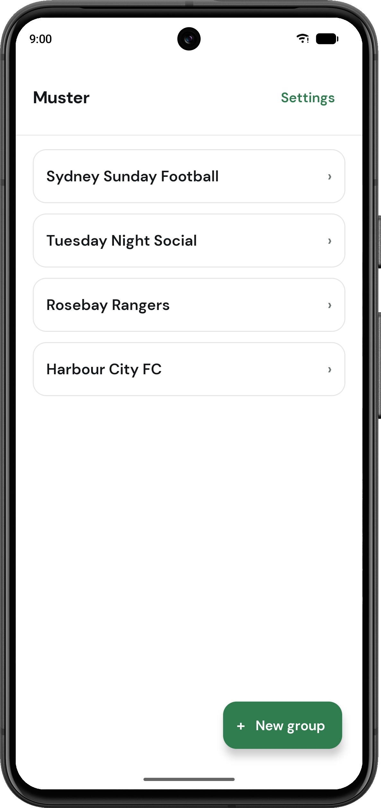
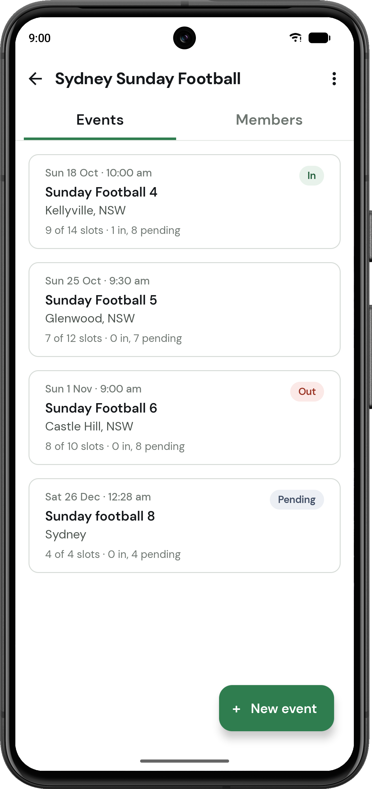
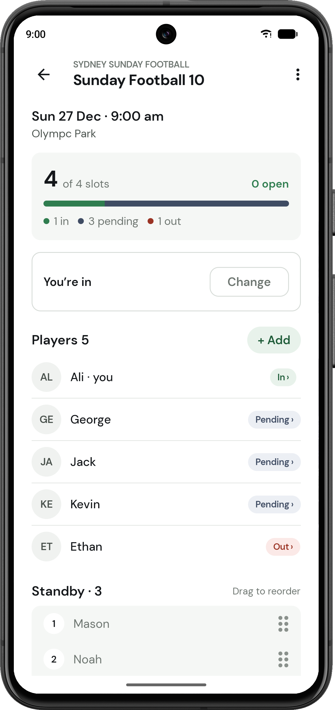
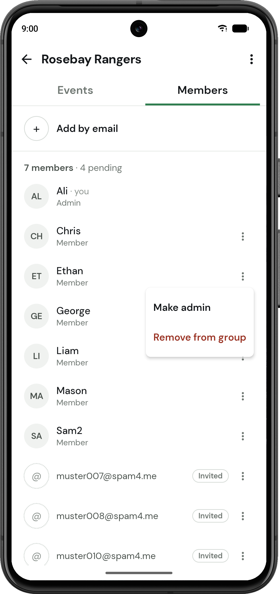

# Muster

[](https://github.com/alirezasobht/Muster/actions/workflows/pr-checks.yml)

Muster organises groups that meet up regularly. Admins create events with
a fixed number of places and invite players by email. Anyone beyond the
limit joins an ordered standby queue, and when someone drops out, the next
person in line is invited automatically.

I built it to replace Teamer for my own football teams. I independently
designed and built the Android, iOS and web apps, the backend, and the CI/CD
pipelines that deliver them.

**[Google Play](https://play.google.com/store/apps/details?id=app.muster.prod)**
· **iOS:** in App Store review <!-- TODO: TestFlight public link -->
· **[Web app](https://www.musterapp.fyi/)**

| Home | Events |
|:---:|:---:|
|  |  |

| Event | Members |
|:---:|:---:|
|  |  |

## Technical highlights

- **One codebase, three platforms.** Android, iOS and web share the
  Compose UI, ViewModels and data layer in one Kotlin Multiplatform
  (KMP) module; each platform app is a thin host. The web app uses
  Kotlin/Wasm with a JS fallback for browsers without Wasm GC, so shared
  dependencies must also support Wasm.

- **Security is enforced in PostgreSQL.** The app communicates directly
  with Supabase, so the client cannot be trusted to enforce permissions.
  Row Level Security controls data access, while database write permissions
  are restricted to Postgres functions that validate the caller and
  enforce business rules.

- **Capacity and standby management live in the database.** PostgreSQL
  triggers enforce event capacity and automatically promote players from
  the standby queue when places become available. Deferred triggers
  handle cascading deletes too, and since it all runs in the database,
  nobody needs the app open.

- **Concurrent changes stay consistent.** Writes take row locks in a
  consistent order. Locking the event row stops two simultaneous
  drop-outs from promoting the same player twice; locking the group row
  stops two admins demoting each other at once and leaving the group
  with none.

- **Database errors become typed errors.** Postgres error codes are
  mapped to a `DomainError` in one place. The UI uses it to decide
  whether an error belongs under a field or above the button, and
  whether to keep the action available.

- **Automated testing and delivery.** GitHub Actions runs ktlint,
  Android unit and UI tests, iOS simulator tests, and a web build.
  Production deployment requires approval and includes an encrypted
  database backup, backend and web deployment, and mobile builds
  uploaded to Google Play's internal track and TestFlight.

## Tech stack

| Area | Choice |
|---|---|
| Language | Kotlin |
| Shared code | Kotlin Multiplatform (KMP): Android, iOS, web (Wasm with JS fallback) |
| UI | Compose Multiplatform, Material 3 |
| Presentation | MVVM, coroutines, `StateFlow` |
| Dependency injection | Koin |
| Navigation | Navigation Compose, type-safe routes |
| Backend | Supabase: Postgres, Auth, Row Level Security, Edge Functions |
| Client | supabase-kt on Ktor |
| Email | Resend |
| CI/CD | GitHub Actions |
| Distribution | Google Play, TestFlight/App Store Connect, Cloudflare Pages |
| Code style | ktlint with custom rules |

## Architecture

```
shared/       Compose UI, ViewModels, domain and data, for every platform
androidApp/   Android host
iosApp/       Xcode project, thin SwiftUI wrapper
webApp/       web host and static pages
supabase/     migrations, Edge Functions, deploy scripts
buildSrc/     build-time config generation
```

Inside `shared`, code is split into `ui`, `domain` and `data` packages,
with imports pointing inward: `ui → domain ← data`. Each screen has a
composable, a UI state class and a ViewModel exposing `StateFlow`.

Repository interfaces live in `domain` and are implemented in `data` with
supabase-kt, with in-memory fakes behind the same interfaces for tests.
Koin wires each layer through its own module.

The domain layer is deliberately thin. Capacity, standby promotion, the
last-admin rule and the event freeze are enforced in Postgres; a second
copy in Kotlin would drift and couldn't be enforced on the client anyway.

More in [ARCHITECTURE.md](docs/ARCHITECTURE.md) and
[SCHEMA.md](docs/SCHEMA.md).

## Features

- Sign in with a six-digit email code. No passwords.
- Groups with admins and members. People are invited by email, whether or
  not they have an account yet, and see nothing until they accept.
- Events with a capacity. Players reply in or out; admins can change
  anyone's reply.
- An ordered standby queue that admins reorder by dragging. The first in
  line is invited as soon as a place frees up.
- Events lock at their start time: no more replies, invitations or
  promotions.
- Groups are archived, never deleted. Accounts can be deleted in the app
  or on the web.

## Testing and CI/CD

Tests:

- ViewModel tests on the JVM, against in-memory fakes. The ViewModels are
  common code, so these cover every platform.
- Mapper and use-case tests.
- Compose UI tests for the screens, on an Android emulator.
- The common tests also run on the iOS simulator and in headless Chrome.

CI/CD, all on GitHub Actions:

- **Pull requests** run ktlint, unit tests with an Android build,
  Compose UI tests on an API 34 emulator, iOS tests on macOS and a web
  build. Platform-specific jobs run when code changes; docs-only changes
  skip those builds.
- **Backend changes merged into `dev`** back up the dev database, then
  deploy its migrations and Edge Functions.
- **Releases** use three workflows. The first bumps the version and opens
  the release PR into `main`. After the merge, the production deploy waits
  for approval, backs up the database, and deploys the backend, the web
  app to Cloudflare Pages, Android to Play's internal track and iOS to
  TestFlight. Store publication is handled separately.
  The last workflow tags the release and merges `main` back into `dev`.

Dev and production are separate Supabase projects. Details in
[CI.md](docs/CI.md).

## Getting started

You need JDK 17+, Android Studio with the Kotlin Multiplatform plugin and
the [Supabase CLI](https://supabase.com/docs/guides/cli), plus Xcode for
iOS. Secrets and per-environment values live in a separate private repo,
so a clone can build and run against its own Supabase project but can't
deploy this one.

1. **Set up a Supabase project**: schema, Vault, Resend and Auth, in
   [environment_setup.md](supabase/docs/environment_setup.md).
   Invitations won't work until every step is done.

2. **Add the build values** to `local.properties` (gitignored):

   ```
   SUPABASE_URL=https://<project>.supabase.co
   SUPABASE_PUBLISHABLE_KEY=<publishable key>
   WEB_APP_URL=<where the web app is served>
   CONTACT_EMAIL=<support address; web build only>
   ```

   The publishable key ships in every build by design; RLS protects the
   data.

3. **Run it:**

   | | |
   |---|---|
   | Android | `./gradlew :androidApp:installDebug` |
   | Web | `./gradlew :webApp:wasmJsBrowserDevelopmentRun` |
   | iOS | open `iosApp/` in Xcode and run |
   | Tests | `./gradlew :shared:testAndroidHostTest` |

Every account can create one live group. To lift the limit for an
address, add it to `private.group_creator_emails` in the Supabase
dashboard. Every other command is in [RUNBOOK.md](docs/RUNBOOK.md).

## Documentation

| Doc | Covers |
|---|---|
| [CONTEXT.md](docs/CONTEXT.md) | Scope, roles and product rules |
| [ARCHITECTURE.md](docs/ARCHITECTURE.md) | Layers, DI, navigation, testing, versioning |
| [SCHEMA.md](docs/SCHEMA.md) | Tables, RLS, triggers and functions |
| [DECISIONS.md](docs/DECISIONS.md) | Why the main choices were made |
| [SCREENS.md](docs/SCREENS.md) | Screen map and navigation |
| [DESIGN.md](docs/design/DESIGN.md) | Visual design |
| [CI.md](docs/CI.md) | Branches, PR checks, deploys |
| [RUNBOOK.md](docs/RUNBOOK.md) | Every command, from a fresh clone |
| [environment_setup.md](supabase/docs/environment_setup.md) | Bringing up a Supabase environment |
| [deploying.md](supabase/docs/deploying.md) | Backend deploy scripts |
| [CHANGELOG.md](CHANGELOG.md) | Releases |
